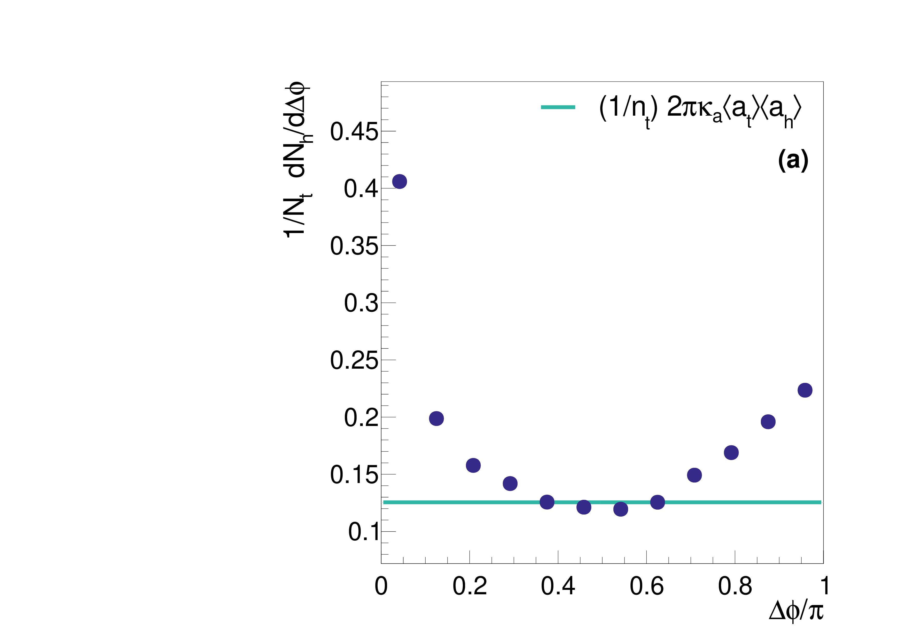
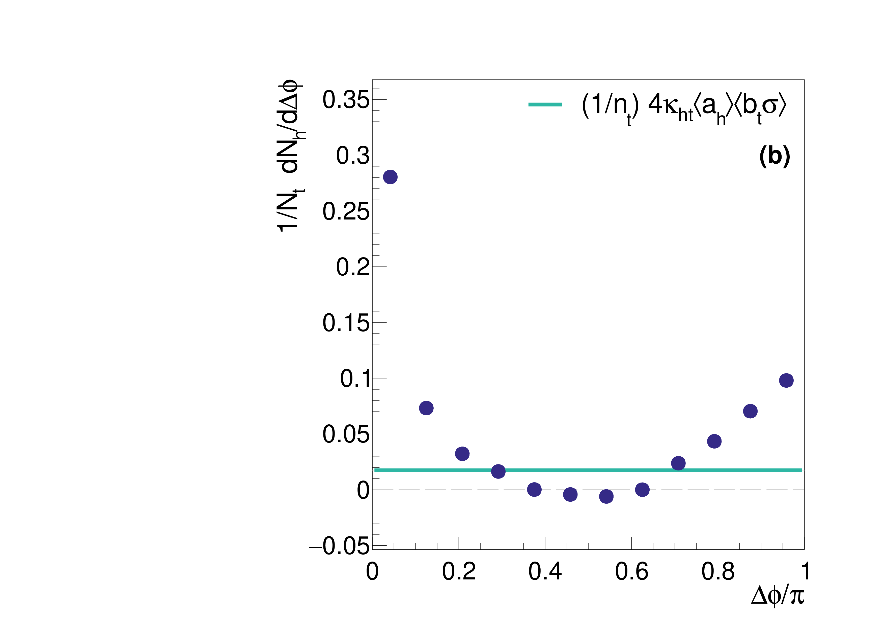
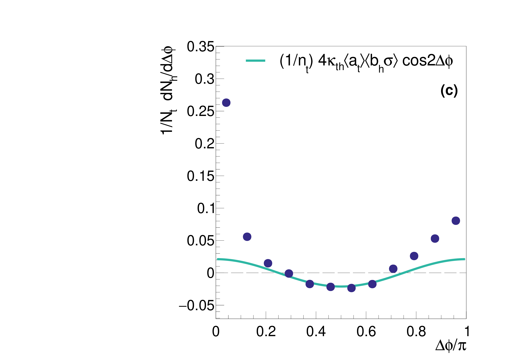

# Reaction-Plane-Dependent Event Mixing

**A self-contained statistical method for extracting signals from noisy, correlated data** — developed for jet tomography of the quark-gluon plasma at RHIC, but the technique generalizes to any setting where the background structure is not independently measurable.

[The Problem](#the-problem) | [The Method](#the-method) | [Mathematics](#mathematics) | [Code](#code-structure) | [Thesis](#thesis)

---

## The Problem

You want to measure correlations between particles emerging from a high-energy heavy ion collision. The signal you care about (from a hard scattering) is an order of magnitude smaller than the background (from collective flow), and the background has the **same angular structure** as the signal. You can't fit it out. You can't measure it independently. Standard approaches rely on external reference data or ad-hoc assumptions.

**This framework measures and removes the entire background using only the data itself** — with no external inputs, no calibration runs, and no free parameters.

## The Method

### Step 1: Event Mixing — Isolate the Uncorrelated Background

Pair trigger particles with hadrons from *different* events in the same centrality class. Since the events are independent, any flow-induced correlations average out, leaving only the flat component:

```
Y_mix(Δφ) = 4π ⟨a_t⟩⟨a_h⟩
```

**The catch**: triggers favor higher-multiplicity events. The correction is a single parameter — **κₐ** — computed from the data.

### Step 2: Reaction-Plane Binned Mixing — Isolate the Correlated Background

Now pair triggers with hadrons from events having the *same reaction-plane orientation*. This preserves the flow correlation:

```
Y_mix^ψ(Δφ) − Y_mix(Δφ) = 2π ⟨σ b_t⟩⟨σ b_h⟩ cos(2Δφ)
```

**The catch**: only the noisy *measured* reaction plane is available. A second correction — **κ_b** — accounts for the resolution damping.

### Step 3: In/Out-of-Plane Decomposition — Extract Geometry Dependence

Constrain triggers to align with or against the reaction plane. The difference isolates cross terms:

```
Y_mix^ψ+ − Y_mix^ψ− = 8 ⟨a_h⟩⟨b_t σ⟩ + 8 ⟨a_t⟩⟨b_h σ⟩ cos(2Δφ)
```

Two more corrections (κ_th, κ_ht) close the system.

### The Four κ Corrections

| Factor | Corrects For | Formula |
|--------|-------------|---------|
| κₐ | Multiplicity bias in flat term | ⟨a_t a_h⟩ / ⟨a_t⟩⟨a_h⟩ |
| κ_b | Resolution damping in cosine term | ⟨b_t b_h⟩⟨σ⟩² / ⟨b_t σ⟩⟨b_h σ⟩ |
| κ_th | Cross-term mismatch (t→h) | ⟨a_t b_h σ⟩ / ⟨a_t⟩⟨b_h σ⟩ |
| κ_ht | Cross-term mismatch (h→t) | ⟨a_h b_t σ⟩ / ⟨a_h⟩⟨b_t σ⟩ |

All four are ~1–5% corrections computed from the same data. Statistical uncertainties are propagated via **1000-trial Monte Carlo pseudo-experiments** that resample the data within their errors.

### The Final Subtraction

```
Y(Δφ) = [Y_same(Δφ) − κₐ·Y_mix(Δφ) − κ_b·(Y_mix^ψ − Y_mix)·cos(2Δφ)] / A(Δφ)
```

The acceptance function A(Δφ) is constructed from the mixed-event yield itself, closure-tested against published spectra.

<p align="center">
  
  
  
</p>
**Figure 1:** Background subtraction sequence (π⁰–h, 20–60% centrality). Left: same-event data with flat background overlaid. Center: after flat subtraction, cosine background overlaid. Right: final cleaned correlation.

### Triangular Flow Elimination

Third-order flow (v₃) vanishes analytically by integrating the away-side over |Δφ − π| < π/3 — no modeling required.

---

## Full Derivation

### 1. Single-Particle Ansatz

Assume the azimuthal distribution of any particle species i is determined by the second-order reaction plane ψ₂:

```
f_i(φ_i, ψ_{2i}) = a_i + b_i cos(2(φ_i − ψ_{2i}))
```

where i ∈ {trigger t, hadron h}. The coefficients a_i and b_i are functions of collision centrality (number of participating nucleons N_part) and transverse momentum p_T. The elliptic flow harmonic is v_{2i} = b_i / 2a_i. Higher harmonics (n > 2) are suppressed: v₃ is eliminated analytically later, and n > 3 terms are negligible.

Integrating over all azimuth and reaction plane gives the mean particle count per event:

```
∫₀²ᵖⁱ dφ_i · (1/π) ∫₀ᵖⁱ dψ_{2i} f_i = n_i = 2π a_i
```

### 2. Same-Event Pair Background

The trigger–hadron pair distribution Δφ = φ_t − φ_h in the same event is the product of single-particle distributions integrated over all angles with the same-event constraint δ(ψ_{2h} − ψ_{2t}):

```
F_th(Δφ) = ∫₀²ᵖⁱ dφ_t · ∫₀ᵖⁱ (dψ_{2t}/π) · f_t
         × ∫₀²ᵖⁱ dφ_h · ∫₀ᵖⁱ dψ_{2h} δ(ψ_{2h}−ψ_{2t}) · δ(Δφ − φ_t + φ_h) · f_h
```

Evaluating the integrals:

```
F_th(Δφ) = 4π a_t a_h + 2π b_t b_h cos(2Δφ)
```

This is the **exact background** that must be removed. The first term is isotropic; the second oscillates with the pair azimuth. Both are proportional to products of the single-particle coefficients.

Averaging over N_part distributions h(N_part) within each centrality bin gives the expectation values actually observed:

```
F_th(Δφ) = 4π ⟨a_t a_h⟩ + 2π ⟨b_t b_h⟩ cos(2Δφ)
```

where ⟨x⟩ = ∫ h(N_part) x(N_part) dN_part.

### 3. Event Mixing — Measuring the Flat Term

Mix triggers from event A with hadrons from event B (same centrality, independent reaction plane). Since ψ_{2t} and ψ_{2h} are independent, the δ(ψ_{2h}−ψ_{2t}) constraint disappears, and the cosine term integrates to zero:

```
E_th = ∫ dφ_t ∫ dψ_{2t} f_t · ∫ dφ_h ∫ dψ_{2h} f_h · δ(Δφ − φ_t + φ_h)
     = 4π ⟨a_t⟩⟨a_h⟩
```

This gives us exactly the flat term of F_th — except that ⟨a_t a_h⟩ ≠ ⟨a_t⟩⟨a_h⟩. The trigger rate increases with N_part, biasing the triggered event sample toward larger N_part than the average mixing event. The hadron yield also increases with N_part. The result is a systematically underestimated flat background.

**Correction κₐ:**

```
κ_a = ⟨a_t a_h⟩ / ⟨a_t⟩⟨a_h⟩
```

To compute κₐ, estimate a_t(N_part) and a_h(N_part) by plotting the per-centrality-bin expectation values ⟨a_t⟩, ⟨a_h⟩ versus ⟨N_part⟩ and interpolating with a cubic spline. The integral over h(N_part) then yields the correction directly. Typical values: 1.01–1.05, increasing in peripheral collisions where the N_part distributions are most asymmetric.

After flat subtraction:

```
F_th − κ_a · E_th = 2π ⟨b_t b_h⟩ cos(2Δφ)
```

Only the cosine term remains.

### 4. Reaction Plane Resolution

We don't know the true reaction plane ψ₂ — only an imperfect measurement ψ₂*. The conditional distribution is Gaussian with period π:

```
g(ψ₂ − ψ₂*) = (1/√{2π ω²}) Σ_{k=−∞}^{∞} exp(−(ψ₂ − ψ₂* + kπ)² / 2ω²)
```

Convolving the single-particle distribution with this kernel damps the flow coefficient by the resolution:

```
f_i* = ∫₀ᵖⁱ dψ_{2i} g(ψ₂ − ψ₂*) f_i
     = a_i + σ b_i cos(2(φ_i − ψ_{2i}*))
```

where σ = exp(−2ω²) is the reaction plane resolution, measurable from the correlation between independent sub-detectors (north/south FVTX halves):

```
σ = √⟨cos(2(ψ_N − ψ_S))⟩
```

### 5. Reaction-Plane Binned Mixing — Measuring the Cosine Term

Now mix triggers with hadrons from events whose measured reaction plane ψ₂* is within ε of the triggered event's. Restricting ψ_{2h}* to [ψ_{2t}* − ε, ψ_{2t}* + ε] preserves the flow correlation:

```
E_th^ψ = ∫ dφ_t ∫ dψ_{2t}* f_t* · (1/2ε) ∫_{ψ_{2t}*−ε}^{ψ_{2t}*+ε} dψ_{2h}* ∫ dφ_h f_h* · δ(Δφ − φ_t + φ_h)
       = 4π ⟨a_t⟩⟨a_h⟩ + 2π · (sin(2ε)/2ε) · ⟨σ b_t⟩⟨σ b_h⟩ cos(2Δφ)
```

With ε = π/80, sin(2ε)/2ε ≈ 1. Subtracting the unmixed result isolates the cosine term:

```
E_th^ψ − E_th = 2π ⟨σ b_t⟩⟨σ b_h⟩ cos(2Δφ)
```

But ⟨b_t b_h⟩ ≠ ⟨σ b_t⟩⟨σ b_h⟩ / ⟨σ⟩² — the resolution damping factor σ correlates with b, so the product of averages differs from the average of the product.

**Correction κ_b:**

```
κ_b = ⟨b_t b_h⟩ ⟨σ⟩² / ⟨σ b_t⟩⟨σ b_h⟩
```

The components ⟨σ b_t⟩ and ⟨σ b_h⟩ are extracted from E_th^ψ and from the in/out-of-plane cross terms below. The true ⟨b_t b_h⟩ requires b_t(N_part) and b_h(N_part), estimated by ⟨b_i⟩ ≈ ⟨σ b_i⟩/⟨σ⟩ (valid because σ varies weakly within a centrality bin) followed by the same spline interpolation used for κₐ.

### 6. In/Out-of-Plane Backgrounds

Restrict triggers to those with measured reaction plane aligned with (in-plane) or perpendicular to (out-of-plane) the trigger azimuth:

```
ψ_{2±}*(φ_t) = φ_t + α ± π/4,   α ∈ {0 (in), π/2 (out)}
```

The same-event backgrounds with these limits are:

```
F_th^± = 2π ⟨a_t a_h⟩ ± 4 ⟨a_h b_t σ⟩
       + (π ⟨b_t b_h⟩ ± 4 ⟨a_t b_h σ⟩) cos(2Δφ)
```

Two new cross terms ⟨a_h b_t σ⟩ and ⟨a_t b_h σ⟩ appear, with opposite signs for in vs. out-of-plane.

### 7. In/Out-of-Plane Event Mixing

Repeat the RP-binned mixing with these same integration limits:

```
E_th^{ψ±} = 2π ⟨a_t⟩⟨a_h⟩ ± 4 ⟨a_h⟩⟨b_t σ⟩ ± 4 ⟨a_t⟩⟨b_h σ⟩ cos(2Δφ)
          + π ⟨σ b_t⟩⟨σ b_h⟩ cos(2Δφ)
```

Taking the difference isolates the cross terms:

```
E_th^{ψ+} − E_th^{ψ−} = 8 ⟨a_h⟩⟨b_t σ⟩ + 8 ⟨a_t⟩⟨b_h σ⟩ cos(2Δφ)
```

The flat piece is obtained by integrating over Δφ; the cosine coefficient by fitting after flat subtraction.

Two more corrections account for the residual mismatches:

```
κ_{th} = ⟨a_t b_h σ⟩ / ⟨a_t⟩⟨b_h σ⟩
κ_{ht} = ⟨a_h b_t σ⟩ / ⟨a_h⟩⟨b_t σ⟩
```

### 8. Corrected Backgrounds

All four κ corrections applied:

**All-plane:**

```
F_th* = 4π κ_a ⟨a_t⟩⟨a_h⟩ + 2π κ_b ⟨σ b_t⟩⟨σ b_h⟩ / ⟨σ⟩² · cos(2Δφ)
```

**In/out-of-plane:**

```
F_th^{±*} = 2π κ_a ⟨a_t⟩⟨a_h⟩ ± 4 κ_{ht} ⟨a_h⟩⟨b_t σ⟩
          + (π κ_b ⟨σ b_t⟩⟨σ b_h⟩ / ⟨σ⟩² ± 4 κ_{th} ⟨a_t⟩⟨b_h σ⟩) cos(2Δφ)
```

### 9. Final Subtraction

The per-trigger yield, corrected for detector acceptance A(Δφ) derived from the mixed-event distribution:

```
Y(Δφ) = [Y_same(Δφ) − κ_a · Y_mix(Δφ) − κ_b · (Y_mix^ψ − Y_mix) · cos(2Δφ)] / A(Δφ)
```

For in/out-of-plane, the ± cross terms are additionally removed using κ_{th} and κ_{ht} with the same structure.

### 10. Triangular Flow Elimination

Expanding the single-particle distribution to include v₃:

```
f_i = a_i + b_2i cos(2Δφ_i) + b_3i cos(3Δφ_i)
```

the pair distribution acquires a cos(3Δφ) term. By choosing the away-side integration limits:

```
∫_{2π/3}^{π} cos(3Δφ) dΔφ = 0
```

the v₃ contribution vanishes identically — no measurement, no model, no assumption. Just the geometry of the integral.

---

## Code Structure

```
src/                          C++ analysis framework
  gamAna.h/cc                 Event loop, track/photon handling
  gamAnaTree/                 Per-event tree building and histogramming
  EmcCluster.h/cc             EMCal cluster reconstruction and shower shapes
  CentralTrackData.h/cc       Track matching, DCA, particle ID
  TriggerParticle.h/cc        Trigger selection (photon, π⁰, asymmetric cuts)

macros/                       ~70 ROOT/C++ analysis and plotting macros
  artist_gamAnaTree.C         Main driver: Δφ histograms, event mixing
  acceptCorrect.C             Detector acceptance from RP-dependent mixing
  calcKComponents.C           κ corrections
  subtractKWeightedBG.C       Full background subtraction
  integAwaySide.C             Integrated yields and v₂ extraction
  CalcRPReso.C                Reaction plane resolution
  getFlow.C                   Flow background isolation
  draw*.C                     Publication figures
```

C++17 with ROOT. Processed ~20B minimum-bias Au+Au events over the grid (PROOF). Events are compressed offline for flexible cross-event mixing.

---

## About

**Z. Rowan**, "Removal of Anisotropic Background from Neutral Pion and Tagged Direct Photon–Hadron Correlations of Au+Au 200 GeV Collisions," PhD thesis, CUNY Graduate Center, 2022.

Advisor: Prof. Stefan Bathe. Built with the PHENIX Collaboration at RHIC, Brookhaven National Laboratory.
